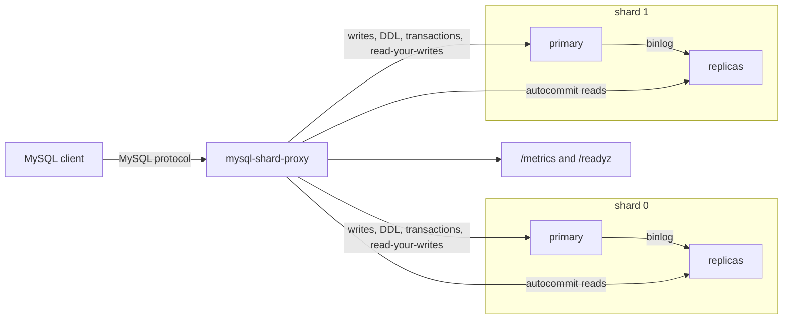

# mysql-shard-proxy

A MySQL-protocol proxy that hash-shards queries and splits reads across replicas. It is a portfolio project for database-infrastructure work: the proxy speaks the MySQL wire protocol, routes by a configured shard key, keeps a per-session read-your-writes window, and takes lagging replicas out of rotation.

Clients connect to the proxy as if it were MySQL. Each shard is a primary plus zero or more replicas. The ordinal of a key is FNV-1a 32-bit modulo the number of shards, in the order the shards are listed in the config.

## Architecture



Inside the process, each client session parses one statement, builds a route, and borrows a pooled backend connection. A health checker probes primaries with `SELECT 1` and replicas with `SHOW REPLICA STATUS` (falling back to `SHOW SLAVE STATUS`). Replicas that are down or past the lag threshold leave rotation and return after consecutive successful probes.

## Quick start

The Compose file publishes local-only default passwords (`localdev`). Override them with environment variables if you want different values. They are not credentials for any real system.

```bash
docker compose -f deploy/docker-compose.yml up --build
```

That starts two shards (each a MySQL 8.0 primary and one replica) and the proxy.

```bash
mysql -h 127.0.0.1 -P 3306 -uapp -plocaldev
```

```sql
INSERT INTO users (id, user_id, name) VALUES (1, 42, 'ada');
SELECT name FROM users WHERE user_id = 42;
```

`user_id = 42` is hashed onto one shard. The insert goes to that shard's primary. The select goes to a healthy replica, unless this session wrote recently (see read-your-writes). Metrics are on `http://127.0.0.1:9090/metrics`. Readiness is `/readyz` and liveness is `/healthz`.

Run the proxy against your own backends with the example config:

```bash
export PROXY_APP_PASSWORD=...
export MYSQL_APP_PASSWORD=...
mysql-shard-proxy -config config.example.yaml
```

## Configuration

Durations use Go's `time.ParseDuration` syntax (`5s`, `30m`). Passwords prefer `password_env`. A literal `password` is accepted for local files you do not commit.

| Field | Default | Meaning |
| --- | --- | --- |
| `listen` | `0.0.0.0:3306` | MySQL listen address |
| `metrics_listen` | `0.0.0.0:9090` | HTTP address for `/metrics`, `/healthz`, `/readyz` |
| `server_version` | `8.0.36-shard-proxy` | Version string in the handshake |
| `log_level` | `info` | `debug`, `info`, `warn`, or `error`. SQL text is debug only |
| `shutdown_timeout` | `20s` | How long to wait for in-flight sessions on SIGINT/SIGTERM |
| `shard_key` | required | Column name used to choose a shard |
| `sharded_tables` | every table | Tables that must carry the shard key. Other tables go to shard 0 |
| `read_your_writes_window` | `5s` | After a write, pin that session's reads of that shard to the same primary. `0s` disables it |
| `fallback_to_primary` | `true` | Serve a read from the primary when every replica is out of rotation |
| `allow_multi_shard_read` | `false` | Allow `IN (...)` reads that touch more than one shard |
| `allow_scatter_read` | `false` | Allow unconstrained reads to fan out to every shard |
| `users` | required | Client accounts. Each needs `name` and `password` or `password_env` |
| `pool.max_open` | `16` | Max connections per backend |
| `pool.max_idle` | `4` | Idle connections kept per backend |
| `pool.connect_timeout` | `3s` | Dial timeout |
| `pool.acquire_timeout` | `2s` | How long a session waits for a pool slot |
| `pool.conn_max_lifetime` | `30m` | Recycle connections older than this |
| `pool.idle_timeout` | `5m` | Close idle connections |
| `pool.read_timeout` / `write_timeout` | `0` | Optional per-packet deadlines. `0` waits indefinitely |
| `health.interval` | `2s` | Probe period |
| `health.timeout` | `1s` | Per-probe deadline |
| `health.lag_threshold` | `5s` | Replicas with `Seconds_Behind_Source` above this leave rotation |
| `health.failure_threshold` | `2` | Consecutive failures before a healthy backend is removed |
| `health.success_threshold` | `1` | Consecutive successes before an unhealthy backend returns |
| `shards` | required | Ordered list. Index 0 is hash value 0. Each shard has `primary` and optional `replicas` |
| `shards[].*.addr` | required | `host:port` of the backend |
| `shards[].*.database` | empty | Database selected when the pool dials |

Shard order is part of the mapping. Reordering or adding a shard moves keys. This is modulo hashing, not consistent hashing.

`/readyz` returns 200 only after every primary has passed a probe. Backends start out of rotation so a fresh process does not send reads to a replica that is already lagging.

## How to test

```bash
go test -race -count=1 ./...
go vet ./...
```

The race-detector suite is hermetic. It includes unit tests for hashing, SQL routing, the planner, the pool, and the health state machine, plus an in-process integration test that connects a real MySQL client to the proxy and fake MySQL backends. That test checks shard placement, replica reads, the read-your-writes window, transaction pinning, cross-shard rejection, prepared statements, session replay, multi-shard reads, DDL fan-out, replica removal and restore, Prometheus metrics, and graceful shutdown.

`deploy/docker-compose.yml` is a separate MySQL 8.0 topology. CI builds the image and validates the Kubernetes manifests. It does not boot that Compose stack. I did not run a Compose end-to-end test in this environment because Docker was not available here, so treat the stack as a local topology to try, not as a result I measured.

Lint matches CI:

```bash
golangci-lint run --timeout=5m ./...
```

Kubernetes:

```bash
kubeconform -strict -summary -kubernetes-version 1.31.0 deploy/k8s/*.yaml
```

The manifests deploy the proxy only. Create the password secret yourself, and point `shards[].addr` at Services you already run:

```bash
kubectl create namespace mysql-shard-proxy
kubectl -n mysql-shard-proxy create secret generic mysql-shard-proxy \
  --from-literal=proxy-password='replace-me' \
  --from-literal=mysql-password='replace-me'
kubectl apply -f deploy/k8s/
```

No Secret object is committed.

## Design decisions

- The wire protocol comes from `github.com/go-mysql-org/go-mysql` (MIT). The proxy is a server to clients and a client to each backend. TLS is not advertised on the proxy listener; terminate TLS in front of it if you need it.
- Routing uses a small SQL subset parser rather than a full MySQL parser. The shapes it accepts are the ones that can be routed without guessing. Anything else returns a MySQL error (`ER_PARSE_ERROR` or `ER_NOT_SUPPORTED_YET`) instead of being sent to the wrong shard.
- A statement is a write when it is `INSERT`, `UPDATE`, `DELETE`, `REPLACE`, or DDL, or when it is a locking read (`FOR UPDATE`, `LOCK IN SHARE MODE`). Writes go to the primary. Autocommit reads go to a healthy replica, round-robin, unless the session is inside its read-your-writes window.
- Read-your-writes is per session. After a single-shard write the proxy holds that primary connection for the configured window, so a following `SELECT` on the same shard, and `LAST_INSERT_ID()`, see that write. The window is not a cluster-wide clock.
- Transactions are single-shard. `BEGIN` does not pick a shard. The first statement does, on that shard's primary, and later statements that hash elsewhere fail. `autocommit=0` pins the same way. There is no two-phase commit.
- DDL is sent, in order, to every primary. If a later shard fails, earlier shards may already have applied it.
- Multi-shard `UPDATE`/`DELETE` with an `IN` list of shard keys are fanned out to the primaries that own those keys. Multi-row `INSERT` must land on one shard. Multi-shard reads are concatenated only when the statement has no `ORDER BY`, `LIMIT`, `GROUP BY`, `DISTINCT`, or aggregate. Prepared statements that would touch more than one shard are rejected, because the binary result protocol is not merged.
- Pools are per backend. Limits, dial timeout, acquire timeout, max lifetime, and idle timeout are enforced. A connection that has executed a different session prelude is closed instead of reused. `SET` statements are replayed onto a clean connection. `SET GLOBAL`, `SAVEPOINT`, temporary tables, `LOCK TABLES`, joins, subqueries, `UNION`, and `INSERT ... SELECT` are rejected.
- Replica health uses replication thread state and `Seconds_Behind_Source` (or the older `Seconds_Behind_Master`). Unknown lag is treated as unhealthy. Removal and recovery both require consecutive samples so one blip does not flap the pool.
- Metrics are Prometheus counters and histograms for query count and latency labeled by shard, role, statement class, and result, plus pool gauges and backend up/lag gauges. Logs are JSON on stdout and do not include passwords. Query text is logged at debug only.
- Shutdown closes the listen sockets, waits up to `shutdown_timeout` for sessions, force-closes the stragglers, stops probes, and then closes pools.

## Limitations

- The shard map is static modulo hashing. Adding a shard moves most keys. There is no online reshard or dual-write tool in this repository.
- The SQL surface is intentionally narrow. Joins, subqueries, `UNION`, `GROUP BY` across shards, and scatter queries that would return a wrong `ORDER BY` or `LIMIT` are errors. An unconstrained read is an error unless `allow_scatter_read` is set, and even then aggregates and ordering are rejected.
- Cross-shard transactions are rejected. A transaction that starts with an unsharded statement such as `SELECT 1` binds to shard 0 when it is the first statement that needs a backend.
- `LAST_INSERT_ID()` across statements works on the shard that was just written, for the read-your-writes window. With the window set to `0s`, the proxy closes the write connection and clients should use the insert id in the OK packet.
- Fan-out is sequential. A multi-shard write or a DDL statement can partially apply.
- Session state other than replayed `SET` statements and `USE` is not tracked. `GET_LOCK`, temporary tables, and session variables set by stored procedures are unsupported.
- The proxy does not rewrite predicates, cache result sets, or retry a failed statement on another replica.
- Replica lag is whatever MySQL reports in `Seconds_Behind_Source`. That value can be `NULL`, coarse, and misleading under parallel apply. Heartbeat-based lag is not implemented.
- No benchmarks are published here. I did not load-test the proxy.

## AI assistance

This project was built with help from an AI coding agent (Cursor Grok 4.7) and reviewed by the author. The agent generated the implementation, tests, deployment manifests, and this README. The author is responsible for reviewing the design, running the tests, and validating behavior before relying on it.

Direct modules are MIT, BSD, or Apache-2.0: `github.com/go-mysql-org/go-mysql` (MIT), `github.com/prometheus/client_golang` (Apache-2.0), and `gopkg.in/yaml.v3` (MIT and Apache-2.0). The compiled proxy does not import `github.com/go-sql-driver/mysql` (MPL-2.0). That module appears in `go.sum` because upstream test files in go-mysql and the TiDB parser module reference it.
